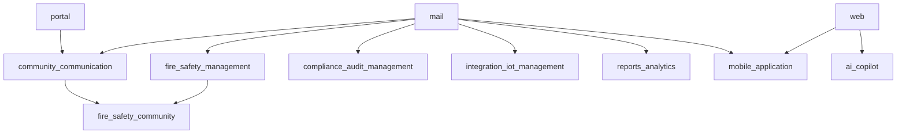

# FMS addon audit (Odoo 19)

Generated from the `fmss` source tree. The eight custom FMS modules in this audit live **at the repository root** of `blu_fms_backend` (same layout as `fmss/<module_name>/`), alongside the seven existing root modules (`apartment_management`, `esg_management`, `gate_management`, `owner_tenant_management`, `property_management`, `resident_management`, `workforce_management`). There is no nested `addons/` directory for these modules.

This document does not audit the seven property/resident modules unless they are added to the dependency graph later.

## Third-party Python imports (custom code)

| Package | Used in | Notes |
|---------|---------|--------|
| `python-dateutil` | compliance (check, document, dashboard), integration_iot (device, reading), reports_analytics (utils) | Already required by Odoo; listed in `requirements.txt` for venv parity |
| stdlib (`json`, `urllib`, `datetime`, etc.) | ai_copilot service, reports utils | No pip install |

No `requests`, `google-generativeai`, `openai`, OCR, or pandas imports in custom addons.

## AI Copilot

- Provider calls use `urllib.request` to configured HTTP endpoints (e.g. Gemini REST).
- API keys stored via `ai.copilot.config` / settings — not in this repository.

## Mobile application

- HTTP JSON API in `controllers/main.py`; frontend uses `/mobile/api/*` routes.
- Integrations (`mobile.integration.community`, `mobile.integration.external`) no-op gracefully when optional FMS models are missing.

## Cron / data XML

Modules ship `data/ir_cron_data.xml` where scheduled jobs exist (community, compliance, fire_safety, integration_iot, reports_analytics). Install/upgrade modules to register crons.

## Known integration notes

- `fire_safety_community` has empty `data` and no `static/`; requires both parent apps installed.
- `community_communication` includes OWL assets under `static/src/components`, `dashboard`, `analytics`, and `views` that are not all listed in `__manifest__.py` `assets`; align manifest if those bundles must load in production.

## Inter-module dependency graph

